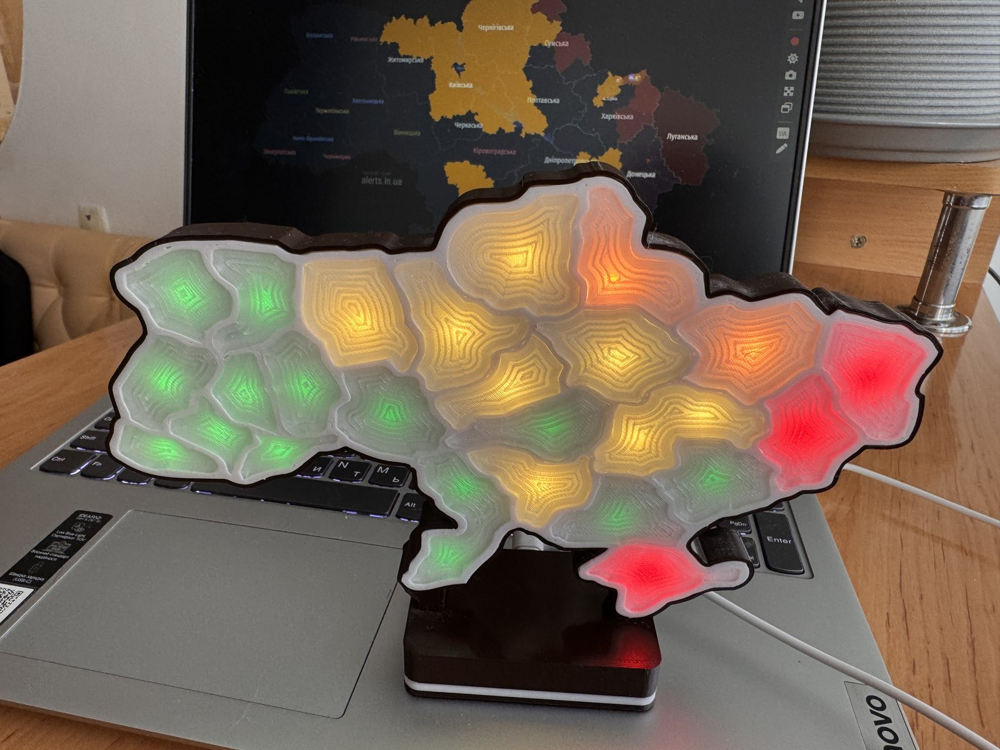

# AlarmMini print files

Original enclosure and LED mounting parts designed by WebDev-Den for the
AlarmMini Ukraine alert map with an ESP32-C3 SuperMini and WS2812B LEDs.

The photograph shows an assembled printed map. Its colours are an example,
not current alert information.

## Files

| File | Part |
| --- | --- |
| [Regions_Box.stl](Regions_Box.stl) | Main map enclosure |
| [Regions_Top.stl](Regions_Top.stl) | Front layer |
| [Regions_WS2812b.stl](Regions_WS2812b.stl) | LED mounting layer |
| [ws2812b_to_module.stl](ws2812b_to_module.stl) | LED module adapter |
| [esp32-c3-box.stl](esp32-c3-box.stl) | ESP32-C3 controller enclosure |
| [Regions_Box.3mf](Regions_Box.3mf) | Editable Bambu Studio project with five plates |

## Printing

Open the 3MF project in Bambu Studio or import the STL files into your slicer.
The saved project uses the Bambu Lab X2D 0.4 mm nozzle profile. Global settings
are 0.2 mm layer height, 2 walls and 100% infill, with supports enabled.
Individual objects may override these settings.

Check the selected printer, plate layout, filament assignments and supports
before slicing. The project contains both PLA and PETG filament slots. These
are saved settings, not a claim that every material or printer has been tested.

## Assembly and setup

You will need an ESP32-C3 SuperMini, WS2812B LEDs, connecting wires, a USB data
cable and a suitable 5 V power supply. Match the LED quantity and supply
capacity to your actual build. Basic soldering is required.

Check the fit of the parts, LEDs and controller before final assembly.
Check the LED data direction and common ground before powering the map.
Install the firmware, configure Wi-Fi and the data source, then calibrate the
LED-to-region assignments in the device dashboard before closing the enclosure.

- [Browser firmware installer](https://alarmmini.vercel.app)
- [Ukrainian and English setup guide](../../../docs/AlarmMini_User_Manual_UA_EN.pdf)
- [Project documentation](../../../README.md)

The firmware also supports Wemos D1 mini. The controller enclosure in this
folder is for ESP32-C3; Wemos support in firmware does not establish its fit here.

## Use and commercial enquiries

These original design files are covered by the repository's
[AlarmMini Non-Commercial License](../../../LICENSE).
Commercial use requires prior written permission from WebDev-Den under those terms.
[Contact the author](https://t.me/+j3zFZHE5gGoyNGYy) for commercial enquiries.
